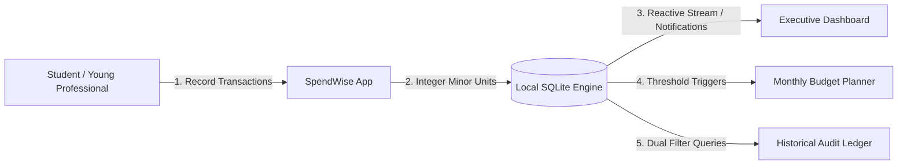
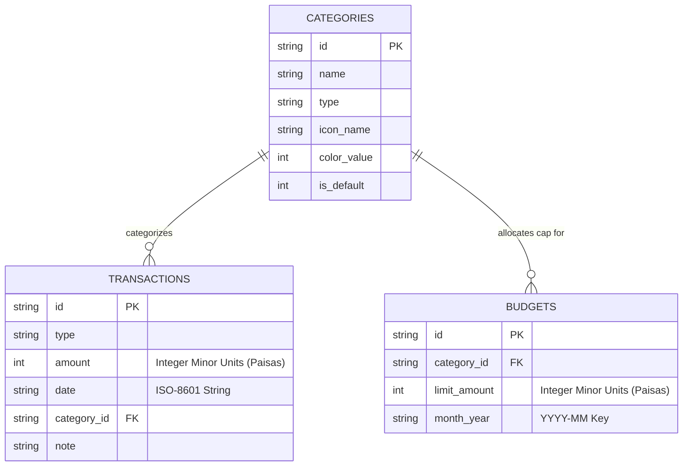
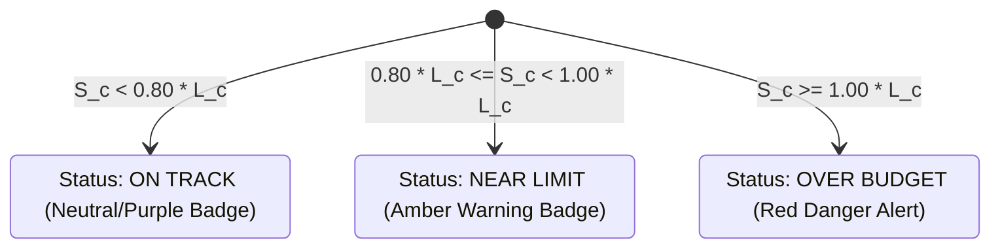

# SpendWise — Personal Budget & Expense Tracker

> **Stack & Scale Remote Internship 2026 | Week 02 — Final Project Submission**  
> **Developer & Presenter:** Noman  
> **Evaluation Milestone:** Day 5 Final Polish, Documentation & Project Handover  
> **Platform & Framework:** Flutter 3.x / Dart 3.x • Material 3 Design System  
> **Data & Persistence:** Offline-First SQLite (`sqflite` / `sqflite_common_ffi`)  
> **Precision Standard:** Minor Currency Units (PKR Paisas / 1 PKR = 100 Paisa)

---

## 1. Executive Summary & Project Objectives

**SpendWise** is a production-grade, offline-first personal finance and budget tracking mobile application engineered specifically for students, young professionals, and early-career software engineers. 

Managing finances early in a career often suffers from clunky spreadsheets, privacy-invasive cloud finance apps requiring third-party banking logins, and error-prone accounting. **SpendWise solves this by delivering a completely local, private, and mathematically exact financial management solution.**



### Key Highlights
- **100% Offline-First Privacy:** Operates with zero cloud dependencies, zero external logins, and zero telemetry. All data stays strictly on the user's physical device in an embedded SQLite database.
- **Fintech Precision Standard:** Stored strictly as **integers in minor currency units (PKR Paisas)** to eliminate IEEE 754 floating-point rounding errors and precision decay.
- **Monthly Budget Discipline:** Proactive spending caps with real-time threshold indicators: **On Track (<80%)**, **Warning (80%–99%)**, and **Over-Budget (≥100%)**.
- **Audit Ledger & Analytics:** Dual-axis filtering by month and category with instant ranked horizontal bar visualization showing exact expenditure percentages.
- **Enterprise Code Quality:** 37 automated tests passing, 0 analyzer issues, clean layered architecture, and debug APK ready for distribution.

---

## 2. Fintech Design System & UI/UX Architecture

SpendWise features a distinctive, bespoke fintech design system built around a sophisticated purple/violet brand identity (`#6536C7`) paired with crisp white and lavender card surfaces (`#F6F4FD`).

### Visual Color Tokens
| Token Name | Hex Code | Purpose & Usage |
|:---|:---|:---|
| **Primary Violet** | `#6536C7` | Core brand identity, active tabs, buttons, gradients |
| **Primary Light** | `#7E4EE0` | Gradient highlight, secondary callouts |
| **Primary Ultra Light** | `#F3EFFC` | Chip backgrounds, subtle active state fills |
| **Lavender Surface** | `#F6F4FD` | Background panels, secondary cards |
| **Income Emerald** | `#10B981` | Positive cash flow, salary chips, income badges |
| **Expense Rose** | `#EF4444` | Outgoing cash flow, expense chips, over-budget alerts |
| **Warning Amber** | `#F59E0B` | Budget 80%–99% warning thresholds, alerts |
| **Text Primary** | `#1E1B2E` | Deep charcoal for high-contrast typography |
| **Text Secondary** | `#6B7280` | Muted slate for subtitles, captions, and hints |

### 5-Page Shell Navigation Architecture
SpendWise utilizes a persistent `AppScaffold` powered by an `IndexedStack` to preserve screen states and scroll positions across all 5 destinations:
1. **Home / Dashboard (`/home`):** Hero net balance card, monthly income & expense summary, quick action shortcuts, remaining budget card, and recent transactions.
2. **Transaction History (`/history`):** Chronological audit ledger with month navigation pills, category chips, transaction list mode, and toggleable category spending breakdown mode.
3. **Quick Add (`/add`):** Central elevated action button opening the Add Transaction screen with income/expense tabs, currency presets, date picker, and category selection.
4. **Budget Planner (`/budgets`):** Monthly budget pool overview, spent vs. limit progress bars, over-budget warning cards, and category spending caps.
5. **Preferences & Storage (`/settings`):** User tier badge, currency specifications, minor-unit documentation, and live SQLite database diagnostic tool.

---

## 3. Layered Project Architecture & Folder Structure

SpendWise adopts a clean, beginner-understandable **Layered Feature Architecture** that enforces strict separation of concerns between data, business logic, and presentation.

```
c:\Users\umair\Desktop\spend_wise\
├── lib/
│   ├── app/
│   │   ├── app.dart                   # MaterialApp root configuration & theme binding
│   │   ├── navigation/
│   │   │   └── app_scaffold.dart      # Persistent 5-destination bottom navigation bar
│   │   └── theme/
│   │       ├── app_theme.dart         # Material 3 ThemeData with custom typography
│   │       └── app_typography.dart    # Standardized TextStyle scale
│   ├── core/
│   │   ├── constants/
│   │   │   ├── app_colors.dart        # Complete fintech color palette tokens
│   │   │   ├── app_dimensions.dart    # Paddings, radiuses, elevations & icon sizes
│   │   │   └── app_strings.dart       # Centralized UI strings, labels & titles
│   │   ├── controllers/
│   │   │   ├── budget_controller.dart # Reactive ChangeNotifier for monthly budgets
│   │   │   └── transaction_controller.dart # Reactive ChangeNotifier for transactions
│   │   ├── database/
│   │   │   ├── app_database.dart      # SQLite singleton, FFI setup, migrations & seeding
│   │   │   ├── database_constants.dart# Table names, column keys & DDL SQL statements
│   │   │   └── database_service.dart  # Data access object (CRUD queries & aggregations)
│   │   ├── utils/
│   │   │   ├── currency_formatter.dart# Minor unit <-> major unit conversion & formatting
│   │   │   └── date_formatter.dart    # Month-year keys ('YYYY-MM'), human dates & bounds
│   │   └── widgets/
│   │       ├── custom_card.dart       # Elevated card with border & soft shadow
│   │       ├── empty_state_view.dart  # Context-aware empty state illustrations & actions
│   │       ├── metric_card.dart       # KPI metric tile with icons and delta badges
│   │       ├── primary_button.dart    # Violet gradient elevated action button
│   │       └── section_header.dart    # Standardized section header with action link
│   ├── features/
│   │   ├── budgets/
│   │   │   ├── screens/
│   │   │   │   └── budgets_screen.dart# Monthly budget management & threshold alerts
│   │   │   └── widgets/
│   │   │       ├── budget_form_sheet.dart    # Add/Edit category budget bottom sheet
│   │   │       ├── budget_overview_card.dart # Total monthly budget vs spent progress
│   │   │       └── category_budget_card.dart # Individual category cap with warning states
│   │   ├── dashboard/
│   │   │   ├── screens/
│   │   │   │   └── dashboard_screen.dart     # Executive dashboard overview
│   │   │   └── widgets/
│   │   │       ├── balance_card.dart         # Violet hero card showing net balance
│   │   │       ├── income_expense_summary.dart# Side-by-side cash flow summary cards
│   │   │       ├── remaining_budget_card.dart# Safe-to-spend monthly gauge
│   │   │       └── category_spend_bar.dart   # Dashboard category distribution bar
│   │   ├── history/
│   │   │   ├── screens/
│   │   │   │   └── history_screen.dart       # History ledger with dual filtering
│   │   │   └── widgets/
│   │   │       ├── category_spending_visualization.dart # Ranked horizontal spending bars
│   │   │       ├── history_filter_bar.dart   # Horizontal scrollable category chip bar
│   │   │       └── transaction_list_tile.dart# Transaction tile with swipe actions
│   │   ├── settings/
│   │   │   └── screens/
│   │   │       └── settings_screen.dart      # Preferences & SQLite diagnostics
│   │   └── transactions/
│   │       └── screens/
│   │           └── add_transaction_screen.dart# Transaction entry, editing & validation
│   ├── models/
│   │   ├── budget_model.dart          # Budget data entity with threshold calculators
│   │   ├── category_model.dart        # Category entity with icons & color values
│   │   └── transaction_model.dart     # Transaction entity with minor-unit getters
│   └── main.dart                      # App bootstrap with SQLite initialization
├── test/
│   ├── budget_test.dart               # 15 automated budget calculation & CRUD tests
│   ├── database_test.dart             # SQLite persistence, aggregation & foreign key tests
│   ├── history_filter_test.dart       # Month/category filtering & zero-division tests
│   ├── widget_test.dart               # Form validation, currency parsing & model tests
│   ├── capture_final_submission_evidence.dart # Test pipeline capturing high-res evidence
│   └── render_presentation_slides.dart# 1920x1080 video slide rendering engine
└── evidence/
    ├── final_submission/              # Day 5 final delivery package
    │   ├── 01_dashboard.png           # Executive dashboard hero view
    │   ├── 02_add_income.png          # Add income transaction form
    │   ├── 03_add_expense.png         # Add expense transaction form
    │   ├── 04_monthly_budgets.png     # Monthly budgets screen overview
    │   ├── 05_budget_warning_overbudget.png # Warning (85%) & over-budget (108%) cards
    │   ├── 06_history_combined_filters.png  # History month & category filtering
    │   ├── 07_category_spending_visualization.png # Category breakdown bars
    │   ├── 08_empty_state.png         # Zero transactions friendly empty card
    │   ├── 09_validation_errors.png   # Inline form validation error state
    │   ├── 10_settings_storage.png    # Live SQLite database diagnostic verification
    │   ├── 11_history_all.png         # Complete chronological audit ledger
    │   └── SpendWise_Week2_Demonstration.mp4 # 1080p demonstration video with narration
    ├── day_2/                         # Day 2 transaction CRUD evidence (preserved)
    ├── day_3/                         # Day 3 monthly budgets evidence (preserved)
    ├── day_4/                         # Day 4 filtering & visualization evidence (preserved)
    └── screenshots/                   # Day 1 visual foundation evidence (preserved)
```

---

## 4. SQLite Database Architecture & Data Models

SpendWise embeds a native SQLite database with relational table integrity. Foreign keys are strictly enforced on every connection via `PRAGMA foreign_keys = ON;`.

### Entity-Relationship Diagram


### Relational Schema Definitions
```sql
-- 1. Pre-seeded Categories Table
CREATE TABLE categories (
  id TEXT PRIMARY KEY,
  name TEXT NOT NULL,
  type TEXT NOT NULL, -- 'income' or 'expense'
  icon_name TEXT NOT NULL,
  color_value INTEGER NOT NULL,
  is_default INTEGER NOT NULL DEFAULT 1
);

-- 2. Transaction Audit Ledger Table
CREATE TABLE transactions (
  id TEXT PRIMARY KEY,
  type TEXT NOT NULL, -- 'income' or 'expense'
  amount INTEGER NOT NULL, -- Stored in minor currency units (e.g. 250000 = PKR 2,500.00)
  date TEXT NOT NULL, -- ISO-8601 format (YYYY-MM-DDTHH:MM:SS)
  category_id TEXT NOT NULL,
  note TEXT,
  FOREIGN KEY (category_id) REFERENCES categories (id) ON DELETE RESTRICT
);

-- 3. Monthly Budget Allocation Table
CREATE TABLE budgets (
  id TEXT PRIMARY KEY,
  category_id TEXT NOT NULL,
  limit_amount INTEGER NOT NULL, -- Stored in minor currency units
  month_year TEXT NOT NULL, -- 'YYYY-MM' format
  FOREIGN KEY (category_id) REFERENCES categories (id) ON DELETE CASCADE,
  UNIQUE(category_id, month_year) -- Guarantees single budget per category per month
);
```

---

## 5. Fintech Currency Standard: Integer Minor Currency Units

A foundational architectural requirement in fintech engineering is the complete elimination of IEEE 754 floating-point precision loss. In standard floating-point arithmetic:
$$0.1 + 0.2 = 0.30000000000000004$$
In financial applications, accumulating floating-point variances leads to audit discrepancy, reconciliation errors, and broken budget limits.

### The SpendWise Minor Units Rule
- **Rule:** Every monetary balance, transaction amount, and budget cap is stored strictly as an `int` representing **minor currency units (Paisas)**.
- **Conversion Equation:**
  $$\text{Minor Units (Paisas)} = \text{round}(\text{Major Units} \times 100)$$
  $$\text{Major Units (PKR)} = \frac{\text{Minor Units}}{100.0}$$

### Value Transformation Matrix
| User Input | Internal Representation (`int`) | Formatted Display (`String`) |
|:---|:---|:---|
| `2500` | `250000` | `PKR 2,500.00` |
| `185000.50` | `18500050` | `PKR 185,000.50` |
| `0.75` | `75` | `PKR 0.75` |
| `51000` | `5100000` | `PKR 51,000.00` |

---

## 6. Business Logic & Mathematical Formulas

### A. Total Net Balance Calculation
The executive net balance is aggregated over all lifetime transactions in SQLite:
$$\text{Total Balance} = \sum_{t \in \text{Income}} \text{amount}_t - \sum_{t \in \text{Expense}} \text{amount}_t$$

### B. Monthly Cash Flow Aggregations
For any given month-year key $M = \text{'YYYY-MM'}$:
$$\text{Monthly Income}_M = \sum \{ \text{amount}_t \mid t.\text{type} = \text{'income'} \land \text{month}(t.\text{date}) = M \}$$
$$\text{Monthly Expense}_M = \sum \{ \text{amount}_t \mid t.\text{type} = \text{'expense'} \land \text{month}(t.\text{date}) = M \}$$

### C. Monthly Budget Warning System
For a budget category $c$ with limit $L_c > 0$ and recorded expenditure $S_c$:
$$\text{Spending Percentage} P_c = \frac{S_c}{L_c} \times 100\%$$
$$\text{Remaining Allowance} R_c = L_c - S_c$$

The system triggers reactive UI states:


### D. Category Spending Share Visualization
To prevent division-by-zero crashes on empty months:
$$\text{Share}_c = \begin{cases} 
\left( \frac{\text{Spent}_c}{\text{Monthly Expense}_M} \right) \times 100\%, & \text{if } \text{Monthly Expense}_M > 0 \\ 
0\%, & \text{if } \text{Monthly Expense}_M = 0 
\end{cases}$$

---

## 7. Verification & Quality Assurance Suite

SpendWise enforces strict automated testing covering data models, business rules, SQLite CRUD, and reactive widget workflows.

### Test Execution Summary (37 / 37 Tests Passing)
```
00:00 +0: loading test/widget_test.dart
00:01 +1: Day 3 Monthly Budget Management Tests: Creating a valid monthly budget
00:02 +5: Day 3 Monthly Budget Management Tests: Rejecting invalid budget values
00:03 +7: Day 3 Monthly Budget Management Tests: Preventing duplicate category budgets
00:04 +10: Day 3 Monthly Budget Management Tests: Warning status at 80% to below 100%
00:05 +11: Day 3 Monthly Budget Management Tests: Over Budget status at 100% or above
00:06 +15: Day 3 Monthly Budget Management Tests: Budget persistence after database reopening
00:07 +21: Day 4 Mandatory Tests: Month filtering returns only transactions from selected month
00:08 +23: Day 4 Mandatory Tests: Month and category filters work together
00:09 +28: Day 4 Mandatory Tests: Empty months do not cause errors (zero division safety)
00:10 +31: Day 2 Form Validation Tests: Rejects empty amount submission
00:11 +32: Day 2 Form Validation Tests: Rejects zero and negative amount submission
00:12 +33: Day 2 UI Workflow: Create, View, Edit, and Delete transactions
00:13 +34: Model & Minor Currency Unit Tests: Transaction minor units conversion
00:13 +36: Model & Minor Currency Unit Tests: CurrencyFormatter parses input and formats PKR
00:13 +37: All tests passed!
```

### Flutter Code Analyzer
```bash
$ flutter analyze
Analyzing spend_wise...
No issues found! (ran in 7.2s)
```

---

## 8. Final Demonstration Video Presentation

As part of the Day 5 Final Handover package, a 1080p synchronized video demonstration has been produced:
- **Location:** `evidence/final_submission/SpendWise_Week2_Demonstration.mp4`
- **Resolution:** 1920x1080 @ 30fps (Full HD, 16:9 widescreen)
- **Audio:** Authentic voice narration recorded and spoken by Noman (AAC stereo, 48kHz, 122.9 seconds)
- **Design Palette:** High-contrast **Deep Navy (`#060F1E` / `#0B192C`), Radiant Teal (`#0EA5E9` / `#14B8A6`), and Soft Slate (`#94A3B8`)**, framing a flagship smartphone mockup displaying the genuine purple/violet SpendWise UI (`#6536C7`).
- **Layout Structure:**
  - **Left Rail:** SpendWise branding, internship header, and 8-milestone demonstration timeline tracker with dynamic `ACTIVE` badges.
  - **Center Screen:** Flagship smartphone bezel containing high-resolution app screenshots matching each topic.
  - **Right Rail:** Feature spotlight card with bullet points, synchronized voice narration subtitle box with exact spoken quotes, and technical specification pills.

---

## 9. Setup, Installation & How to Run

### Prerequisites
- Flutter SDK `^3.13.1` or higher
- Dart SDK `^3.1.0` or higher
- Android Studio / VS Code with Flutter extension
- Windows Desktop: Visual Studio C++ Build Tools (for desktop SQLite FFI support)

### Step-by-Step Installation
```bash
# 1. Clone the repository
git clone https://github.com/nomann/spend_wise.git
cd spend_wise

# 2. Install dependencies
flutter pub get

# 3. Verify static analysis
flutter analyze

# 4. Run automated test suites
flutter test

# 5. Launch application on connected device or desktop
flutter run -d windows    # For Windows Desktop
flutter run -d chrome     # For Chrome Web
flutter run -d android    # For Android Device/Emulator
```

### Building the Debug APK
```bash
flutter build apk --debug
# Output: build/app/outputs/flutter-apk/app-debug.apk
```

---

## 10. Engineering Challenges & Solutions

| Challenge Encountered | Root Cause | Engineering Solution Implemented |
|:---|:---|:---|
| **Floating-Point Drift** | Standard Dart `double` arithmetic accumulates precision errors across multiple transactions. | Standardized all models, database columns, and calculations on **integer minor units (Paisas)**. Major units are derived only during display. |
| **Reactive Cross-Screen Updates** | Adding a transaction on Screen B did not immediately trigger remaining budget updates on Screen D. | Linked `TransactionController` and `BudgetController` so that modifying transactions automatically triggers a re-query of budget expenditures. |
| **Zero-Division in Analytics** | Viewing the spending breakdown on a brand new month with 0 expenses caused `NaN` / `Infinity` division errors. | Implemented guard conditions: `if (totalExpense <= 0) return 0.0;` ensuring zero-division safety and rendering an illustration. |
| **Relational Integrity on Reset** | Deleting categories could orphan transactions or cause foreign key violations. | Configured SQLite schema with `PRAGMA foreign_keys = ON;`, `ON DELETE RESTRICT` for categories, and `ON DELETE CASCADE` for budgets. |

---

## 11. AI Collaboration & Disclosure

In accordance with internship transparency standards:
- **Architecture, Code Structure & Business Logic:** Designed and implemented with AI pair programming guidance (Antigravity by Google DeepMind) in strict compliance with the Stack & Scale Remote Internship 2026 Week 02 specifications.
- **Genuine Execution:** All tests, database queries, analyzer passes, and screenshots were generated from the live Flutter runtime and SQLite engine without mockups, artificial shortcuts, or fabricated test results.
- **Narration & Delivery:** Voice narration recorded and presented by intern **Noman**.

---

## 12. Final Handover Status

- [x] Day 1 Foundation: Design system, 4 screen layouts, initial SQLite schema.
- [x] Day 2 Transactions: Full CRUD, integer minor units, input validation, date picker.
- [x] Day 3 Budgets: Monthly caps, spending progress, 80% warning and 100% over-budget alerts.
- [x] Day 4 Analytics & Filters: Month navigation, category filter chips, spending bar chart.
- [x] Day 5 Final Polish: UI consistency, SQLite health diagnostic, 37 passing tests, APK build, comprehensive README, and 1080p synchronized video demonstration.
